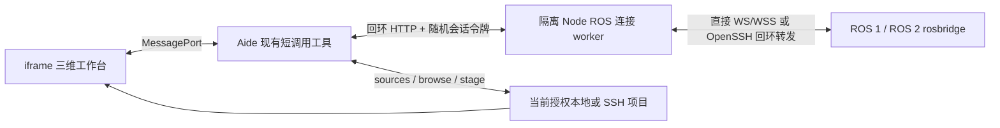
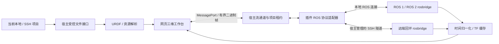

# 架构与接口提案

状态：保留的目标架构与接口提案。2026-10-28 首版实现改用现有短调用工具 + 隔离连接 worker + 有界轮询，不需要修改 Aide。下文 stream/tunnel 宿主接口仍未实现；以 README 和验收记录为当前能力依据。

## 当前预览版的实际链路

UI 每 500ms 请求一次有界快照；worker 处理 ROS 消息并保留最新数据。点云/激光最多 3,000 点，地图最多 16,384 格，单层序列化预览最多 512 KiB，响应最多 900 KiB，连接 worker 的 V8 heap 上限 128 MiB。超过预算明确报错。页面直接网络权限仍关闭，没有修改 Aide 的 iframe CSP。

SSH 使用后端预配置的 OpenSSH alias，未实现自动继承当前 Aide SSH 会话。worker 保存当前来源身份摘要；后续调用身份变化即关闭连接。无法完成关闭调用时以 30 秒空闲超时清理。下面保留的宿主 stream/tunnel API 是后续高带宽方案，不是当前已提供的接口。

## 后续目标架构

## 已核对的宿主边界

本次只读检查了现有 Aide：`internal/server/plugin_workbench.go` 的 iframe CSP 包含 `connect-src 'none'`；`web/plugin-workbench-client.js` 提供 MessagePort、工具调用、文件相关方法与 scope.revoked 事件，没有可直接采用的高带宽订阅 API。现有 daemon 协议提供常驻进程和 NDJSON 事件，但不能仅凭它认定点云流已经可用。

`internal/server/ssh_session.go` 使用 OpenSSH ControlMaster / ControlPath 管理项目 SSH 会话，非 Go ssh.Client 的任意 Dial 接口。隧道应由宿主基于实际现有机制扩展，并遵循原有凭据和主机密钥流程；本设计不假定现成隧道 API 已存在。

## 模块职责

- 工作台：Three.js 场景、相机、图层、属性面板、诊断；消息解码在 Worker，UI 不持有 SSH 凭据。
- ROS 适配器：ROS 1/2 类型、消息时间、订阅参数、只读 rosapi 发现、压缩协商。拒绝任意 publish 和非白名单 service 操作。
- TF：缓存按连接/项目隔离；组合变换、时间匹配、静态与动态边分开。/clock 回退清空动态时序缓存；fixed frame 不可达时显式报错。
- 资源解析：URDF 与 package:// 依赖只走当前项目授权源；路径解析后再次核验边界。Xacro 不在浏览器中隐式执行。
- 生命周期：租约绑定插件、项目身份/代际和工作台实例。关页、禁用、切换项目、锁定或断线撤销租约，清理订阅、解码任务、GPU 资源和隧道。

## 泛化宿主接口草案

| 操作（拟） | 参数和结果 | 边界 |
| --- | --- | --- |
| stream.open | 声明的传输配置 → 不透明 leaseId、预算 | 用户连接动作触发；宿主核验目标与项目 |
| stream.subscribe | leaseId、白名单话题、类型与速率 → subscriptionId | ROS 协议适配器验证；不开放任意网络代理 |
| stream.frame | subscriptionId、sequence、generation、bytes | 有界可转移 ArrayBuffer，收到消费回执后推进 |
| stream.close | leaseId | 幂等关闭并取消所有挂起工作 |
| tunnel.open | 当前 SSH 项目、批准的远端回环端口 → 内部句柄 | 无任意 SSH 命令，无凭据回传，无公网监听 |

宿主只实现可复用的受控传输与撤销机制；ROS 语义留插件。以上需要对主程序做最小通用扩展，不能承诺纯插件零宿主修改。若宿主能力缺失，应显示版本/能力错误，不回退绕过 CSP。

握手核验协议和预算；默认不自动重新连接。用户开启自动重连后指数退避，同一项目代际才恢复订阅。帧携带序号和代际，旧连接残留数据丢弃。控制消息与大帧分通道，防止点云阻塞取消操作。最新帧队列与流控必须端到端实施，不只在渲染端截断。

## ROS 2 QoS 和时间

上游 rosbridge 2.1 协议描述 subscribe 的 qos 字段，也注明同话题共享底层订阅的限制；不能假定所有已安装 bridge 都实现该版本。连接诊断记录服务器/软件版本来源；无法可靠探测时要求选择明确兼容配置并验证 /tf_static 等实际收包。

所有证据记录 source stamp、receive time、ROS time 与 connection generation；不把到达时间冒充采集时间。TF 外推、时钟不一致和无时间戳必须有可见策略。

## 依赖与证据

参考来源（2026-10-28 核对）：
- https://github.com/RobotWebTools/rosbridge_suite/blob/ros2/ROSBRIDGE_PROTOCOL.md
- https://github.com/ros2/rviz
- https://github.com/ros2/rviz/blob/rolling/LICENSE
- Aide 本地宿主源码与 `docs/en/plugins/daemon-protocol.md`

采用浏览器原生显示架构，不直接打包 Qt/OGRE RViz。依赖版本、许可证和源码指纹需在引入时固定并写 THIRD_PARTY_NOTICES。未复制任何私有插件实现。

验收证据按 fixtures / unit / ROS 集成 / SSH / 浏览器 / 包安装分层记录；未跑项明确 NOT_RUN。现阶段只有接口盘点与本文档完成，所有运行链路尚未验收。
